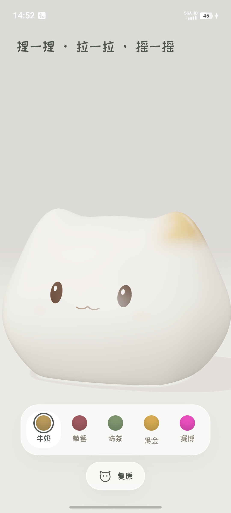

# squee · 猫咪牛奶布丁

A squeezable cat pudding for Android — one `WebView` wrapping a bundled WebGPU / WebGL 2 soft-body
scene. No permissions, no network, no tracking.



一只住在手机里的小猫布丁。按住它身体的任何地方往哪边拉，它就往哪边变形；松手，它会晃回原来的形状。
摇一摇手机，它会抓着你的手翻个滚。软体是 CPU XPBD 体积约束，240 Hz 固定步长，整只猫都在设备本地
实时求解 —— 无后端、无网络、无埋点。

界面基于上游「Milk & meow · 猫咪牛奶布丁」精简而来，物理求解器本身一行没改。
完整的改动清单见 [`docs/upstream-changes.md`](docs/upstream-changes.md)。

## 概况

| | |
|---|---|
| 口味 | 牛奶 / 草莓 / 抹茶 / 黑金 / 赛博，各配一套猫脸与材质 |
| 手感 | 单指按压、双指捏拢、摇一摇翻滚、猫头按钮复原 |
| 软体 | 486 体积节点 / 1920 四面体 / 9216 可见三角面，240 Hz 求解 |
| 渲染 | 原生 WebGPU，拿不到就退回 WebGL 2（Android 全平台可用） |
| 包体 | `assets/dist` 约 900 KB JS + 3.6 KB CSS，全部随 APK 分发 |
| 权限 | **无**（manifest 里一个都没声明） |
| 兼容 | `minSdk 24`，`target/compile 35` |

## 构建

只出 APK，不需要碰网页工程 —— 预构建的 `assets/dist` 已经在仓库里：

```sh
cd android
./gradlew :app:assembleDebug     # -> app/build/outputs/apk/debug/app-debug.apk
./gradlew :app:lintDebug         # 必须保持 0 error
```

需要 JDK 21 和 Android SDK（platform 35、build-tools 35+）。

要重新构建网页包（改了源码或想跟上上游新版），先把上游克隆到**同级目录**：

```sh
git clone https://github.com/lunaark/milk-meow-jelly.git ../milk-meow-jelly
bash scripts/sync_web.sh                    # npm install → typecheck → test → build → 同步进 assets/
bash scripts/sync_web.sh /path/to/checkout  # 或指定任意路径
```

`sync_web.sh` 会把上游的 `LICENSE`、`docs/upstream-readme.md` 和本仓库的 `NOTICE.md` 一起复制进
`assets/dist`，MIT 署名随二进制分发。它还会在 `src/` 里扫 `TEMP DIAG` / `XXX` / `FIXME`，发现残留就中止打包。

## 真机验证

```sh
bash scripts/verify_device.sh               # 或 scripts/verify_device.sh <serial>
adb 走 PATH，可用 ADB 环境变量覆盖
```

脚本会安装、启动、等页面就绪，然后打印 WebGPU 探测结果并存一张截图到 `artifacts/`：

```
page: PROBE gpu=false webgl2=true ua=Mozilla/5.0 (Linux; Android 15…) …
```

- `gpu=true` → 原生 WebGPU 路径。
- `gpu=false webgl2=true` → 回退路径，多数设备是这一种。
- 两个都 `false` → WebView 的软件光栅化被禁用，App 层无法补救。

加 `-Psquee.forceWebgl=true` 打包，或给页面地址加 `?webgl`，可强制走回退路径来验证它。
`-Psquee.shake=3` 会在启动后自动摇三次，不用真的摇手机。

## 仓库结构

```
├─ LICENSE                      MIT（本封装）
├─ NOTICE.md                    上游署名：lunaark/milk-meow-jelly、pudding-lab、three.js
├─ docs/
│  ├─ upstream-changes.md       相对上游的 11 处改动，含 rebase 说明
│  ├─ release.md                发版流程：签名构建 → tag → Release 挂 APK
│  └─ android-notes.md          WebView 壳的平台细节与踩过的坑
├─ patches/squee-ui.diff        对上游的补丁（11 个文件），用于跟进新版
├─ scripts/
│  ├─ sync_web.sh               构建上游网页工程并同步 dist/ 进 Android assets
│  ├─ verify_device.sh          装到真机、探测 GPU、截图
│  └─ verify_{poke,shake}.mjs   通过 devtools socket 注入触摸 / devicemotion 的真机回归
├─ store/                       上架素材：商店文案、隐私政策、图标、特色图、真机截图
├─ artifacts/                   图标与特色图的产出目录（verify_device.sh 的截图也落这里）
└─ android/
   ├─ app/src/main/
   │  ├─ java/me/copycat/squee/MainActivity.kt   整个 App：一个 WebView + 一个 https asset origin
   │  ├─ assets/dist/                            预构建的网页包（勿手改）
   │  └─ res/                                    图标、主题、备份规则
   └─ tools/                                     生成 launcher 图标与商店图的脚本
```

## 许可

本封装（Gradle 工程、`MainActivity`、启动图标）为 MIT，见 [`LICENSE`](LICENSE)。

随包分发的网页应用沿上游 MIT 许可，署名见 [`NOTICE.md`](NOTICE.md)（同时随 APK 打进
`assets/dist/NOTICE.md`）。「Milk & meow」「猫咪牛奶布丁」与猫形象归原作者所有 ——
本仓库是非官方重打包，仅供学习与演示，不得商用。
